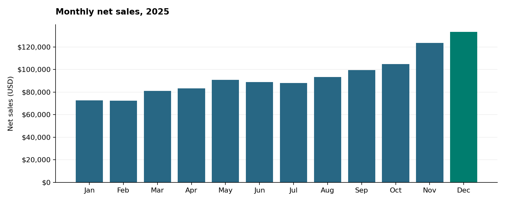

# Retail Sales Analysis with SQL Server

A portfolio case study analyzing a year of **synthetic retail transactions**. The analysis answers four business questions: How did sales and profit change over time? Which categories and products performed best? How often did buyers return? Which sales channels had the most cancellations?

| Net sales | Gross profit | Gross margin | Completed orders | Average order value |
| ---: | ---: | ---: | ---: | ---: |
| $1,131,584.80 | $417,932.79 | 36.93% | 6,036 | $187.47 |

## Findings

| Question | What the sample data shows |
| --- | --- |
| When were sales strongest? | December led with **$133,209** in net sales. November had the strongest month-over-month growth at **17.71%**. |
| Which categories performed best? | **Electronics** led net sales at **$351,176.20**. **Travel** had the highest gross margin at **41.80%**. |
| Which customers came back? | **81.60%** of corporate buyers completed at least two orders during the year (173 of 212). **28.18%** of January's first-time buyers placed another completed order in February (93 of 330). |
| Where were cancellations most common? | **Marketplace** had the highest cancellation rate at **8.35%** (94 of 1,126 orders), compared with **2.66%** for stores (55 of 2,068). |

For an equivalent real dataset, the channel gap would be a starting point for investigating cancellation reasons. The synthetic data demonstrates the analysis workflow and supports no claims about real retailer performance.

## Dataset and schema

The dataset covers January through December 2025. It includes 4 regions, 3 channels, 3 customer segments, and 5 product categories.

| Table | Rows | One row represents |
| --- | ---: | --- |
| Customers | 1,800 | One customer with a region and segment |
| Products | 40 | One product with a category and unit cost |
| Orders | 6,400 | One placed order with a channel and status |
| OrderItems | 14,406 | One product per order with quantity, unit price, discount, and returned units |

One customer can place many orders. Each order can have multiple line items, and each line item references one product. Primary keys, foreign keys, and check constraints enforce those relationships and the allowed quantity, discount, and return ranges.

## Run locally

Use SQL Server 2016 or newer with SQL Server Management Studio (SSMS). Create a fresh practice database, select it in each query window, and run the following files in order.

| Step | File | What it does |
| ---: | --- | --- |
| 1 | [setup.sql](setup.sql) | Creates the schema and indexes. |
| 2 | [seed.sql](seed.sql) | Loads all four tables in a transaction. |
| 3 | [quality_checks.sql](quality_checks.sql) | Checks order line coverage, returns on cancelled orders, dates, and expected table counts. Every failure count should be zero. |
| 4 | [analysis.sql](analysis.sql) | Returns eight grids covering KPIs, monthly growth, category performance, product rankings, regional channel results, repeat buyers, acquisition cohorts, and cancellations. |

`setup.sql` and `seed.sql` are intended to run once in a fresh database. The analysis script can be rerun after the data is loaded.

## Metric definitions

- **Net sales** sum retained units × unit price × (1 − discount rate) for completed orders. Retained units equal ordered units minus returned units. Each line is rounded to cents before aggregation.
- **Gross profit** subtracts the cost of retained units from net sales. **Gross margin** divides gross profit by net sales. The dataset excludes operating expenses, tax, and shipping.
- **Average order value** divides net sales by distinct completed orders, including orders whose units were all returned.
- **Repeat buyer rate** measures the share of buyers with at least two completed orders in 2025. **Next-month cohort activity** measures the share of first-time buyers who completed an order in the next calendar month. The December cohort has no observable next month.
- **Cancellation rate** divides cancelled orders by all placed orders, including cancelled orders.

The SQL uses a temporary sales fact table to apply consistent metric definitions. It uses joins and conditional aggregation for segmentation, `LAG` for month-over-month comparisons, and `DENSE_RANK` to retain ties in the top three product ranks within each category.
